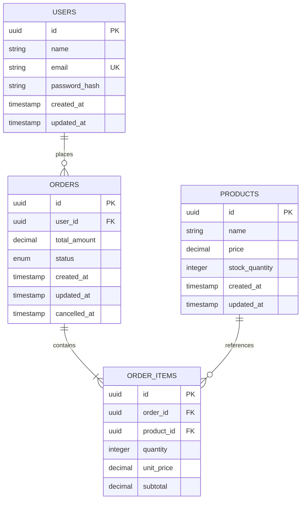

# القرارات الهندسية والمعمارية (Engineering Decisions & System Architecture)

تم إعداد هذا المستند للإجابة الهندسية التفصيلية عن الأسئلة المعمارية الثلاثة المطلوبة في الاختبار التقني، مع تقديم تبريرات عملية مدعومة بكود التنفيذ الفعلي ونتائج الاختبارات الواقعية.

---

## السؤال الأول: ليه صممت قاعدة البيانات كده؟ (Database Architecture & Design Rationale)

تم تصميم قاعدة البيانات وفق أعلى معايير هندسة البيانات (3NF - Third Normal Form) وسلامة المعاملات المالية (ACID Compliance) لضمان عدم حدوث أي تضارب أو فقدان للبيانات.



### 1. لماذا تم فصل Users وProducts وOrders وOrder Items؟

- **مبدأ المسؤولية الواحدة (Single Responsibility Principle) وفصل الاهتمامات**:
  كل جدول يمثل كياناً مستقلاً (Domain Entity):
  - `users`: يدير الهوية والمصادقة والملف الشخصي.
  - `products`: يدير الكتالوج والأسعار والمخزون الحي المتاح للبيع.
  - `orders`: يدير المعاملة التعاقدية (Transactional Header)، الحالة العامة للطلب (`PENDING`, `COMPLETED`, `CANCELLED`)، الإجمالي المالي، والمستخدم المشتري.
  - `order_items`: يدير تفاصيل السلة (Line Items) لكل منتج داخل الطلب الواحد.
- **علاقة One-to-Many و Many-to-Many**:
  الطلب الواحد قد يضم منتجاً واحداً أو عدة منتجات، والمنتج الواحد يطلبه ملايين المستخدمين. فصل `order_items` يمنع تكرار البيانات (Denormalization Anomalies) ويتيح مستقبلاً إضافة خصومات أو ضرائب على مستوى العنصر الفردي.

### 2. لماذا احتفظنا بسعر المنتج وقت الطلب (`unit_price` في `order_items`)؟

- **ثبات السجل المالي (Price Snapshot / Historical Immutability)**:
  إذا قام متجر بتعديل سعر لابتوب من \$1000 إلى \$1200 اليوم، يجب ألا تتغير فواتير وحسابات الطلبات التي تم شراؤها الشهر الماضي.
  تخزين `unit_price` و`subtotal` في جدول `order_items` لحظة الشراء يضمن:
  - حماية السجلات المحاسبية والقانونية للشركة.
  - دقة عمليات استرداد الأموال (Refunds) وإلغاء الطلبات بالسعر الفعلي الذي دفعه العميل.
  - استقلال العمليات المحاسبية عن أي تعديل يجريه مدير المتجر على جدول `products`.

### 3. القيود وسلامة البيانات (Constraints & Referential Integrity)

تم تطبيق قيود قوية على مستوى محرك قاعدة البيانات (Database-Level Enforcement)، لأن الاعتماد على فحص التطبيق فقط (Application-Level Validation) غير كافٍ ومعرض للالتفاف عند وجود ثغرات أو وصول مباشر للبيانات:

- **Primary Keys**: استخدام معرفات UUID لجميع الجداول لمنع تخمين المعرفات (Enumeration Attacks) وتمكين التوزيع الأفقي لاحقاً.
- **Foreign Keys مع سياسات Referential Actions مدروسة**:
  - `orders.user_id -> users.id` مع `ON DELETE RESTRICT`: يُمنع تماماً حذف مستخدم لديه سجل طلبات مالي، حفاظاً على التقارير المالية والضريبية.
  - `order_items.product_id -> products.id` مع `ON DELETE RESTRICT`: يُمنع حذف منتج تم بيعه مسبقاً لمنع تحول بنود الطلبات إلى سجلات يتيمة (Orphan Records).
  - `order_items.order_id -> orders.id` مع `ON DELETE CASCADE`: إذا أُلغي إنشاء الطلب أو حُذف مسودته، تُحذف عناصره الفرعية تلقائياً.
- **Check Constraints الفيزيائية**:
  ```sql
  ALTER TABLE "products" ADD CONSTRAINT "products_stock_quantity_non_negative_check" CHECK ("stock_quantity" >= 0);
  ALTER TABLE "products" ADD CONSTRAINT "products_price_non_negative_check" CHECK ("price" >= 0);
  ALTER TABLE "order_items" ADD CONSTRAINT "order_items_quantity_positive_check" CHECK ("quantity" > 0);
  ALTER TABLE "order_items" ADD CONSTRAINT "order_items_unit_price_non_negative_check" CHECK ("unit_price" >= 0);
  ALTER TABLE "order_items" ADD CONSTRAINT "order_items_subtotal_non_negative_check" CHECK ("subtotal" >= 0);
  ```
  هذه القيود تضمن أن محرك PostgreSQL يرفض فيزيائياً أي عملية كتابة تجعل المخزون سالباً، حتى لو فشل كود التطبيق في فحصها.

### 4. الفهارس (Indexing Strategy) ومبرراتها

تم تجنب وضع فهارس عشوائية تستهلك الذاكرة وتبطئ عمليات الكتابة (Write Amplification)، واقتصرت الفهارس على الاستعلامات الفعلية للنظام:

1. **`users(email)` (Unique B-Tree Index)**:
   - يضمن عدم تكرار الحسابات.
   - يجعل فحص البريد عند تسجيل الدخول استعلاماً فائق السرعة بزمن \(O(\log N)\).
2. **`products(name)` (B-Tree Index)**:
   - يدعم البحث والفرز في كتالوج المنتجات.
3. **`orders(user_id, created_at DESC)` (Composite B-Tree Index)**:
   - هذا أهم فهرس مركب في النظام؛ لأنه يخدم استعلام المستخدم لعرض طلباته مع التصفح:
     `SELECT * FROM orders WHERE user_id = $1 ORDER BY created_at DESC LIMIT 10 OFFSET 0`
   - وجود `created_at DESC` داخل الفهرس نفسه بجانب `user_id` يلغي الحاجة لعملية فرز مكلفة في الذاكرة (Avoids In-Memory Sort / Temp File Spilling).
4. **`orders(status)`**:
   - يسرّع استعلامات العمليات والتقارير بحسب حالة الطلب.
5. **`order_items(order_id)` و `order_items(product_id)`**:
   - تسريع عمليات الـ JOIN عند جلب عناصر الطلب وتدقيق مبيعات المنتج.

---

## السؤال الثاني: كيف منعت بيع أكثر من المخزون؟ (Concurrency Control & Race Condition Prevention)

هذا هو التحدي الهندسي الأساسي، وتم حله بطريقة حاسمة ومثبتة عملياً باختبار تزامن حقيقي لـ 100 طلب متزامن على القطعة الأخيرة.

### 1. ما هي المشكلة التقنية؟ (The Race Condition Problem)

في التطبيقات المبتدئة، يكتب المهندس الكود التالي:

```typescript
// ❌ خطأ شائع قاتل يسبب Race Condition
const product = await prisma.product.findUnique({ where: { id: productId } });
if (product.stock_quantity >= requestedQty) {
  // نافذة زمنية خطيرة (Time-Of-Check to Time-Of-Use Window)
  await prisma.product.update({
    where: { id: productId },
    data: { stock_quantity: product.stock_quantity - requestedQty },
  });
  await prisma.order.create(...);
}
```

**لماذا يفشل هذا الأسلوب؟**
عندما يرسل 100 مستخدم طلباً في نفس الميلي ثانية والكمية المتبقية قطعة واحدة:
1. تقرأ جميع الطلبات المئة المخزون من الذاكرة فيجدونه `1`.
2. تجتاز جميع الطلبات المئة شرط `if (stock >= 1)` بنجاح.
3. يقوم كل طلب بإنشاء طلب شراء وخصم المخزون.
4. النتيجة: **بيع 100 قطعة بينما المخزن لا يحتوي إلا على قطعة واحدة** (Double Selling)، وربما يصبح المخزون `-99`!

### 2. الحل الهندسي المعتمد: Atomic Conditional UPDATE داخل Transaction

اعتمدنا استراتيجية التحديث الذري المشروط (Atomic Conditional UPDATE) على مستوى محرك قاعدة بيانات PostgreSQL داخل معاملة ACID (`prisma.$transaction`):

```typescript
// ✅ الكود الفعلي المطبق في orders.service.ts
const updatedProducts: Array<{
  id: string;
  name: string;
  price: Prisma.Decimal;
  stock_quantity: number;
}> = await tx.$queryRaw`
  UPDATE "products"
  SET "stock_quantity" = "stock_quantity" - ${item.quantity},
      "updated_at" = NOW()
  WHERE "id" = ${item.productId}
    AND "stock_quantity" >= ${item.quantity}
  RETURNING "id", "name", "price", "stock_quantity"
`;

if (updatedProducts.length === 0) {
  // المخزون نفد أو لا يكفي -> إجهاض فوري وإرجاع خطأ 409 Conflict
  throw new InsufficientStockException(
    `Insufficient stock for product. Requested: ${item.quantity}`,
  );
}
```

### كيف يمنع PostgreSQL التزامن في هذه اللحظة؟

1. **Row-Level Exclusive Locking**: عندما تستلم قاعدة البيانات 100 استعلام `UPDATE` متزامنة على نفس السجل، يمنح محرك PostgreSQL قفل السطر الحصري (`RowExclusiveLock`) لأول معاملة تصل إلى السطر.
2. **انتظار المعاملات (Queueing)**: المعاملات الـ 99 الأخرى تقف في طابور الانتظار (Wait Queue) على مستوى نواة محرك قاعدة البيانات حتى تكتمل المعاملة الأولى.
3. **تنفيذ التحديث وإعادة تقييم الشرط**:
   - تنجح المعاملة الأولى في خصم المخزون من `1` إلى `0`، وتُنشئ الطلب وتعمل `COMMIT`.
   - تستيقظ المعاملة الثانية في الطابور لقراءة السطر، فتعيد تقييم جملة `WHERE` فوراً:
     `WHERE id = $id AND stock_quantity >= 1`
   - تجد أن `stock_quantity` أصبح حالياً `0`!
   - شرط `0 >= 1` يرجع `FALSE`.
4. **تحديث 0 أسطر (Zero Rows Affected)**:
   - جملة الـ UPDATE للمعاملة الثانية والـ 98 معاملة المتبقية لا تطابق أي أسطر وتُرجع مصفوفة فارغة `[]`.
5. **الرد الفوري والـ Rollback**:
   - يتحقق كود الخدمة: إذا كان طول المصفوفة `0`، يرمي فوراً استثناء `InsufficientStockException`.
   - يقوم NestJS عبر الـ Exception Filter بتحويلها إلى رد `409 Conflict`.
   - تتراجع المعاملة (Rollback) بالكامل، ولا يتم إنشاء أي طلب أو سطر مالي، ولا تحدث سجلات يتيمة.
6. **الحصن النهائي (Check Constraint)**:
   - حتى لو حدث أي خطأ برمجي غير متوقع، فإن قيد `CHECK (stock_quantity >= 0)` سيرمي خطأ `check_violation` على مستوى محرك قاعدة البيانات، مانعاً أي قيمة سالبة فيزيائياً.

---

### 3. إثبات عملي: نتائج اختبار 100 طلب متزامن على آخر قطعة (Live Test Results)

تم تنفيذ اختبار حقيقي في ملف [`test/concurrency.integration.spec.ts`](file:///e:/API/test/concurrency.integration.spec.ts) باستخدام قاعدة بيانات PostgreSQL حقيقية، بإطلاق 100 طلب HTTP فعلي في نفس اللحظة عبر `Promise.allSettled`:

```
PASS test/concurrency.integration.spec.ts (28.81 s)
  Concurrency & Race Condition Verification (Real PostgreSQL)
    √ 12. CRITICAL TEST: 100 simultaneous concurrent orders competing for the LAST remaining single item (stock=1) (5534 ms)
    √ CRITICAL TEST: 20 simultaneous concurrent cancellation attempts on the SAME order (744 ms)
```

**الأدلة الرقمية من الاختبار الفعلي:**
1. **الطلبات الناجحة (HTTP 201)**: **1 طلب فقط** (`expect(successCount).toBe(1)`).
2. **الطلبات المرفوضة (HTTP 409)**: **99 طلباً بالضبط** مرفوضة بنفاد المخزون (`expect(conflictCount).toBe(99)`).
3. **المخزون النهائي في PostgreSQL**: **0 بالضبط** (`expect(finalProduct.stock_quantity).toBe(0)`).
4. **عدد الطلبات المخزنة في جدول `orders`**: **1 فقط** (`expect(totalOrdersInDb).toBe(1)`).
5. **عدد عناصر `order_items`**: **1 فقط** (`expect(totalOrderItemsInDb).toBe(1)`).
6. **غياب أي أخطاء جانبية**: صفر طلبات يتيمة أو أخطاء غير معالجة (`expect(unexpectedResponses.length).toBe(0)`).

---

### 4. آلية إلغاء الطلب الذرية (Atomic Idempotent Cancellation)

لمنع إعادة شحن المخزون مرتين عند النقر المتكرر أو إرسال طلبات إلغاء متزامنة (Double Restocking Attack):

```sql
UPDATE "orders"
SET "status" = 'CANCELLED'::"OrderStatus",
    "cancelled_at" = NOW(),
    "updated_at" = NOW()
WHERE "id" = $orderId
  AND "user_id" = $userId
  AND "status" = 'COMPLETED'::"OrderStatus"
RETURNING "id";
```

- إذا أرسل المستخدم 20 طلب إلغاء متزامن:
  - طلب واحد فقط ينجح في تحويل الحالة من `COMPLETED` إلى `CANCELLED`، ويعيد المخزون في نفس المعاملة.
  - الـ 19 طلباً الأخرى تفشل في مطابقة الشرط (`status = 'COMPLETED'`) لأن الحالة أصبحت بالفعل `CANCELLED`، وترد بالخطأ `400 Bad Request`.
  - النتيجة مثبتة في اختبار الـ 20 طلب إلغاء متزامن: **تمت استعادة المخزون مرة واحدة فقط**.

---

## السؤال الثالث: إيش بتغيّر لو المتجر وصل مليون منتج وعشرة آلاف طلب في الدقيقة؟ (Scaling to 1M Products & 10,000 RPM)

عند الوصول إلى **1,000,000 منتج** و **10,000 طلب في الدقيقة** (ما يعادل ~167 طلب شراء/ثانية ومئات آلاف طلبات التصفح/ثانية)، تتغير طبيعة الاختناقات (Bottlenecks) من مجرد كتابة استعلام صحيح إلى إدارة الموارد، وأقفال الجداول، وحجم الاتصالات (Connection Pool Exhaustion).

نقدم هنا خطة هندسية واقعية مجدولة بحسب الأولويات والضرورة التقنية، مع توضيح تكلفة كل تقنية والمشكلة المحددة التي تحلها، متجنبين الإفراط في التعقيد (Over-engineering).

---

### أولاً: ما الذي ننفذه فوراً (Phase 1: Immediate & High-ROI Optimizations)

هذه الخطوات لا تتطلب تغييرات جذرية في البنية، وتمنح النظام قدرة استيعاب هائلة بتكلفة منخفضة جداً:

#### 1. إدارة اتصالات قاعدة البيانات (Connection Pooling عبر PgBouncer)
- **المشكلة**: كل طلب HTTP يفتح اتصالاً بـ PostgreSQL يستهلك ~10MB من ذاكرة السيرفر، وقاعدة البيانات تبدأ بالانهيار عند تجاوز 300-500 اتصال متزامن (PostgreSQL Process-per-connection model).
- **الحل**: وضع **PgBouncer** أمام PostgreSQL بوضع `Transaction Pooling`.
- **النتيجة**: خفض الاتصالات المفتوحة بقاعدة البيانات من 10,000 إلى 50-100 اتصال فعلي نشط يعاد استخدامها باستمرار، مع زمن استجابة شبه فوري للاتصال.
- **التكلفة التشغيلية**: منخفضة جداً، خادم صغير (1 vCPU, 2GB RAM).

#### 2. التخزين المؤقت للكتالوج (Redis Caching مع Cache-Aside Pattern)
- **المشكلة**: في التجارة الإلكترونية، نسبة القراءة إلى الكتابة هي عادة `95% قراءة (تصفح، بحث، تفاصيل منتج)` مقابل `5% كتابة (شراء)`. استعلامات `GET /api/products` لمليون منتج ستجهد قاعدة البيانات بلا مبرر.
- **الحل**:
  - تخزين بيانات المنتجات الأكثر طلباً وصفحات الفهارس في **Redis** مع TTL (مثلاً 5 إلى 15 دقيقة).
  - إبطال الكاش (Cache Invalidation) الموجه عند تعديل السعر أو بيانات المنتج.
- **النتيجة**: تفريغ 90% من استعلامات القراءة من قاعدة البيانات وتحقيق استجابة بـ Sub-millisecond.

#### 3. فهارس متقدمة والبحث بالنصوص (PostgreSQL Full-Text Search & pg_trgm)
- **المشكلة**: البحث باستخدام `LIKE '%search%'` أو `ILIKE` على 1,000,000 منتج يسبب Full Table Scan مكلفاً وبطيئاً جداً.
- **الحل**:
  - تفعيل إضافة `pg_trgm` في PostgreSQL وإنشاء GIN Trigram Index:
    ```sql
    CREATE EXTENSION IF NOT EXISTS pg_trgm;
    CREATE INDEX products_name_trgm_idx ON products USING gin (name gin_trgm_ops);
    ```
- **النتيجة**: البحث في مليون منتج بسرعة فائقة مع دعم الأخطاء الإملائية والبحث الجزئي دون الحاجة الفورية لتشغيل Elasticsearch.

#### 4. فصل القراءة عن الكتابة (Read Replicas)
- **المشكلة**: استعلامات التقارير وتصفح الكتالوج تنافس عمليات الـ UPDATE وكتابة الطلبات على نفس الموارد.
- **الحل**:
  - سيرفر **Primary (Master)** مخصص لعمليات الكتابة فقط (إنشاء الطلبات وتعديل المخزون).
  - عدد 2 إلى 3 سيرفرات **Read Replicas** عبر PostgreSQL Streaming Replication لخدمة استعلامات `GET /api/products` و `GET /api/orders`.
- **النتيجة**: ضمان عدم تأثر سرعة معالجة الطلبات بعمليات تصفح الجمهور.

---

### ثانياً: ما الذي ننفذه عند الحاجة اللاحقة (Phase 2: High-Scale Architecture Under Extreme Contention)

تُنفذ هذه المرحلة إذا كان المتجر يواجه حملات "Flash Sale" عنيفة (مثل بيع 5000 تذكرة أو هاتف في 10 ثوانٍ):

#### 1. حجز المخزون الموزع السريع (Redis Distributed Inventory Reservation مع Lua Scripting)
- **المشكلة**: على الرغم من أن الـ Atomic UPDATE في PostgreSQL يضمن عدم بيع أكثر من المخزون بنسبة 100%، إلا أن 10,000 طلب متزامن يتنافسون على سطر واحد (Hot Row Lock Contention) يسبب طابور انتظار طويل (Lock Queue Wait) في قاعدة البيانات.
- **الحل**:
  - إدارة المخزون اللحظي عبر Redis الذري باستخدام كود **Redis Lua Script**:
    ```lua
    -- atomic_decrement.lua
    local current = redis.call('get', KEYS[1])
    if current and tonumber(current) >= tonumber(ARGV[1]) then
        return redis.call('decrby', KEYS[1], ARGV[1])
    else
        return -1
    end
    ```
  - يتم رفض الـ 9,999 طلباً الزائدة على مستوى Redis في الذاكرة (Memory-speed) خلال 0.5 ميلي ثانية.
  - فقط الطلب الذي حجز بنجاح في Redis يُسمح له بالانتقال إلى PostgreSQL لتسجيل الطلب المالي.
- **المشكلة التي يحلها**: حماية قاعدة البيانات من التعرض لآلاف المعاملات المتنافسة على نفس السجل.
- **التكلفة**: تتطلب معالجة مزامنة البيانات بين Redis وPostgreSQL في حال حدوث عطل (Cache-DB Reconciliation Job).

#### 2. المعالجة غير المتزامنة لطوابير الطلبات (Message Queue: BullMQ / Kafka)
- **المشكلة**: إذا تدفقت 10,000 طلب في الدقيقة دفعة واحدة، فبدلاً من إجهاد السيرفرات بمعالجة متزامنة متكتلة قد تسبب Timeout للعملاء:
- **الحل**:
  - يستلم الـ API الطلب، يتحقق من الحجز السريع، ويضع المعاملة في طابور (Queue) مثل BullMQ (المعتمد على Redis) أو Apache Kafka.
  - يرد السيرفر على العميل فوراً: `202 Accepted { orderTrackingId: "..." }`.
  - تقوم مجموعة Workers بسحب الطلبات بمعدل معالجة مستقر (Rate Smoothed) وإتمام الفاتورة وإرسال الإيميلات.
- **التكلفة**: تعقيد في واجهة المستخدم (تتطلب Polling أو WebSockets لإعلام العميل بانتهاء المعالجة).

#### 3. تقسيم الجداول (Declarative Table Partitioning)
- **المشكلة**: عند وصول الطلبات إلى ملايين السجلات سنوياً، يتضخم جدول `orders` و `order_items` ليصبح عشرات الجيجابايت، مما يثقل الفهارس والنسخ الاحتياطي.
- **الحل**: تقسيم جدول `orders` شهرياً أو سنوياً بحسب `created_at` (Partition by Range).
- **النتيجة**: استعلامات الطلبات الحديثة تبحث فقط في القسم (Partition) النشط، ويمكن أرشفة الأقسام القديمة بسهولة.

---

### جدول المقارنة الهندسية: ما نطبقه أولاً وما نؤجله

| التقنية / الحل | الترتيب الزمني | المشكلة التي يحلها | التكلفة والتعقيد الهندسي |
| :--- | :---: | :--- | :--- |
| **PgBouncer** | **المرحلة 1 (فوراً)** | استنزاف اتصالات وسيرفر قاعدة البيانات | منخفضة جداً (إعداد سهل وعائد فوري) |
| **Redis Read Cache** | **المرحلة 1 (فوراً)** | إرهاق قاعدة البيانات بطلبات تصفح الكتالوج | منخفضة (أنماط كاش قياسية) |
| **Read Replicas** | **المرحلة 1 (فوراً)** | عزل قراءات الكتالوج عن كتابة الطلبات | متوسطة (إدارة سيرفر قاعدة بيانات إضافي) |
| **Composite & GIN Indexes** | **المرحلة 1 (فوراً)** | بطء استعلامات التصفح والبحث في 1M منتج | شبه مجانية (تعديل في الـ Schema) |
| **Redis Lua Inventory** | **المرحلة 2 (عند ضغط خيالي)** | Row-Lock Contention على نفس السلعة في التخفيضات | متوسطة إلى عالية (تتطلب مطابقة الكاش بالقاعدة) |
| **Kafka / BullMQ** | **المرحلة 2 (عند الحاجة)** | تسوية قمم الطلبات (Traffic Spike Smoothing) | عالية (معالجة غير متزامنة، وتتبع الأخطاء) |
| **Database Sharding** | **مؤجل جداً (Last Resort)** | تجاوز الحدود الفيزيائية لسيرفر واحد عملاق | معقدة ومكلفة جداً، ولا يحتاجها المتجر في هذه المرحلة |

---

### الخلاصة الهندسية

التصميم المنفذ حالياً يمتلك أساساً صلباً يضمن:
1. **صحة المعاملات 100%**: منع بيع أي قطعة غير موجودة، وانعدام المخزون السالب عبر قيود PostgreSQL وAtomic UPDATE.
2. **قابلية التوسع الأفقي**: الـ API عديم الحالة (Stateless) ومستعد للعمل وراء أي Load Balancer (مثل NGINX أو AWS ALB) مع أي عدد من الـ Containers.
3. **وضوح خريطة التوسع**: انتقال سلس وتدريجي من معالجة المعاملات المباشرة إلى الكاش والطوابير مع تزايد ضغط العمل الفعلي خطوة بخطوة.
